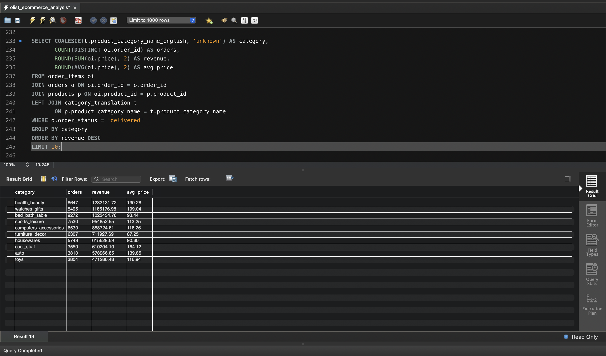
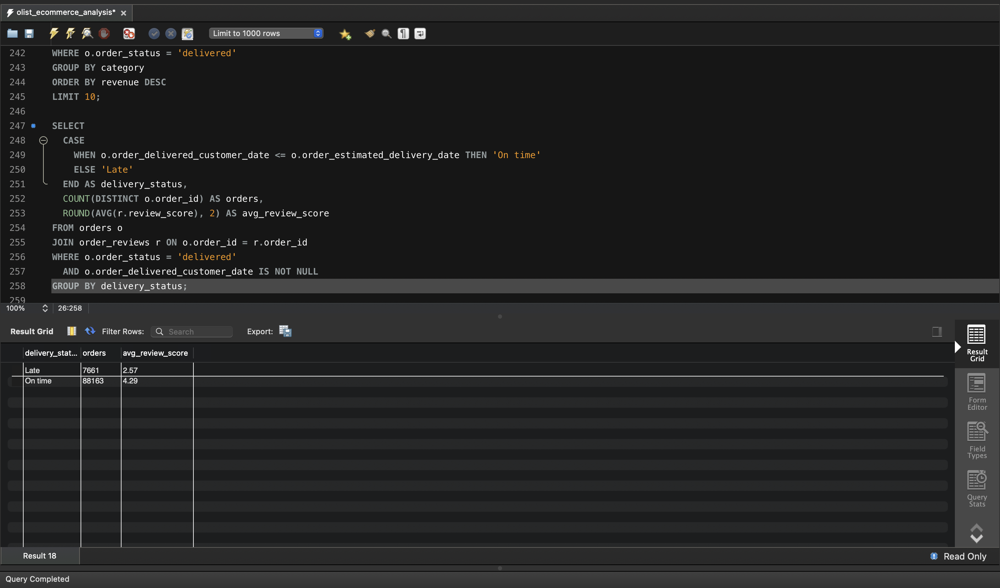
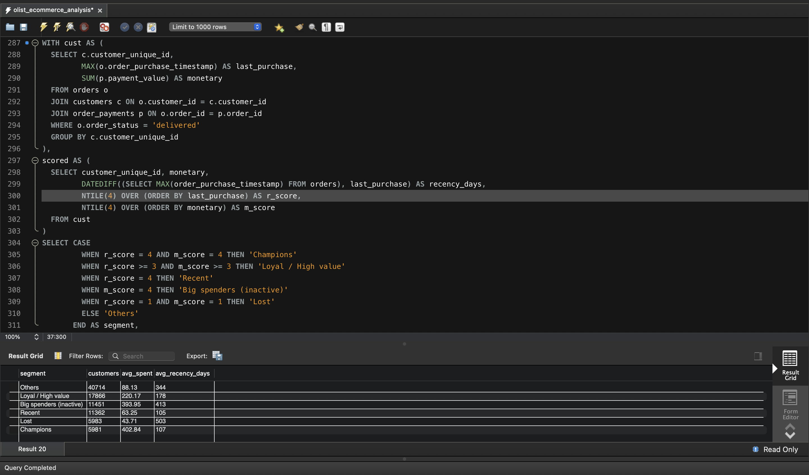

# E-commerce Business Intelligence Using SQL (MySQL)

An end-to-end SQL analysis of a real Brazilian e-commerce marketplace (Olist): schema design, data import and cleaning, and seven business questions answered with SQL.

**Tools:** MySQL 8, MySQL Workbench
**SQL skills shown:** relational schema design (PK/FK), `LOAD DATA` with NULL handling, multi-table JOINs, CTEs, window functions (`LAG`, `NTILE`, `SUM() OVER`), conditional aggregation, `CASE`, `HAVING`

## Dataset

[Brazilian E-Commerce Public Dataset by Olist](https://www.kaggle.com/datasets/olistbr/brazilian-ecommerce) (Kaggle): anonymized real orders, 9 related tables.

| Table | Rows |
|---|---|
| customers | 99,441 |
| orders | 99,441 |
| order_items | 112,650 |
| order_payments | 103,886 |
| order_reviews | 99,224 |
| products | 32,951 |
| sellers | 3,095 |
| geolocation | 1,000,163 |
| category_translation | 71 |

## Project structure

| File | Purpose |
|---|---|
| `01_schema_and_import.sql` | Creates the tables with keys and imports the CSV files |
| `02_analysis.sql` | The seven business questions, each with a comment |

## How to reproduce

1. Download the CSV files from Kaggle.
2. In `01_schema_and_import.sql`, replace `/path/to/archive/` with your folder path.
3. Enable local infile: `SET GLOBAL local_infile = 1;` and add `OPT_LOCAL_INFILE=1` to the Workbench connection (Advanced > Others), then reconnect.
4. Run `01_schema_and_import.sql`, then `02_analysis.sql`.

## Data preparation notes

- `review_id` and `geolocation` rows are not unique in the source, so those two tables have an index instead of a primary key.
- Empty date fields (for example orders never delivered) are loaded as `NULL`.
- Windows line endings (`\r`) are stripped during import.
- The analysis uses **delivered orders only**, unless stated otherwise.
- `customer_unique_id` identifies a person. `customer_id` changes with every order, so it cannot be used to count repeat customers.

## Business questions and findings

### 1. Monthly revenue and orders
The marketplace grew fast through 2017: revenue went from about 127K (Jan 2017) to about 701K (Sep 2017), and monthly orders from 750 to 4,150. Late 2016 has very few orders (for example one order in Dec 2016), so it is excluded from growth calculations.

### 2. Month-over-month growth
Growth is volatile but trending up: +112.7% in Feb 2017 and +52.7% in Mar 2017 (inflated by a small starting base), +45.0% in May, with dips in Apr (-5.7%) and Jun (-13.6%).

### 3. Top categories by revenue (item price only)

| Category | Orders | Revenue | Avg price |
|---|---|---|---|
| health_beauty | 8,647 | 1.23M | 130 |
| watches_gifts | 5,495 | 1.17M | 199 |
| bed_bath_table | 9,272 | 1.02M | 93 |
| sports_leisure | 7,530 | 955K | 113 |
| computers_accessories | 6,530 | 889K | 116 |

- `watches_gifts` earns almost as much as `health_beauty` with about 36% fewer orders, thanks to a higher average price.
- `bed_bath_table` has the most orders but ranks third in revenue because of a low average price (93).

### 4. Late delivery and review scores

| Delivery | Orders | Avg review score |
|---|---|---|
| On time | 88,163 | 4.29 |
| Late | 7,661 | 2.57 |

About 8% of delivered orders arrive late, and those orders score about 1.7 points lower. This is a strong association, not proof of causation: product quality and seller issues may also play a role.

### 5. Late-delivery rate by state (states with 500+ orders)

| State | Delivered orders | Late | Late % |
|---|---|---|---|
| MA | 717 | 141 | 19.7 |
| CE | 1,279 | 196 | 15.3 |
| BA | 3,256 | 457 | 14.0 |
| RJ | 12,350 | 1,664 | 13.5 |
| SP | 40,494 | 2,387 | 5.9 |
| PR | 4,923 | 246 | 5.0 |

MA and CE have the highest rates, but RJ and BA combine a high rate with large volume. SP has the most late orders in absolute terms (2,387) despite a low rate.

### 6. Repeat customers

| Type | Customers | Share |
|---|---|---|
| One-time | 90,557 | 97.0% |
| Repeat | 2,801 | 3.0% |

Only 3% of customers bought again, so retention is a bigger opportunity than acquisition. The window covers roughly two years, so the true repeat rate may be higher.

### 7. Customer segments (Recency + Monetary)

| Segment | Customers | Avg spent | Avg days since last order |
|---|---|---|---|
| Others | 40,714 | 88 | 344 |
| Loyal / High value | 17,866 | 220 | 178 |
| Big spenders (inactive) | 11,451 | 394 | 413 |
| Recent | 11,362 | 63 | 105 |
| Lost | 5,983 | 44 | 503 |
| Champions | 5,981 | 403 | 107 |

Frequency is excluded on purpose because about 97% of customers ordered once. "Others" is a residual group, not a behavioral segment.

## Recommendations

1. **Fix delivery estimates and logistics** in high-volume, high-delay states (RJ, BA); late orders cost about 1.7 review points.
2. **Win back "Big spenders (inactive)"**: 11,451 customers averaging 394 in spend, a cheaper target than new acquisition.
3. **Push a second-order offer to "Recent" customers** to convert them into loyal ones.
4. **Promote high-ticket categories** such as `watches_gifts` and `cool_stuff`, where each order is worth more.

## Limitations

- Revenue is measured differently across questions: Q1, Q2 and Q7 use `payment_value` (includes freight), while Q3 uses item `price`, so the totals are not directly comparable.
- Observational data: relationships (such as delay and rating) are not proven causes.
- The dataset covers about two years, which limits repeat-purchase analysis.
